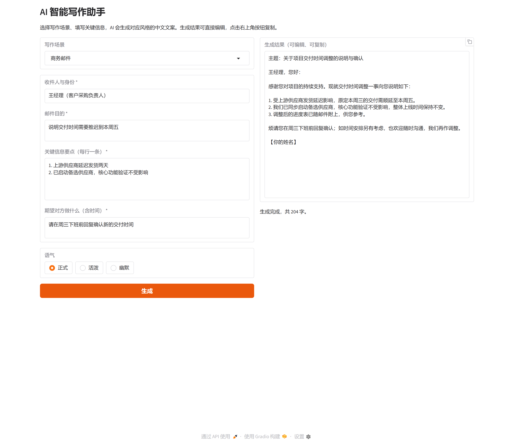

# AI 智能写作助手

> 选择写作场景、填写关键信息，AI 生成对应风格的中文文案；结果可直接编辑、复制。

一个基于 **Gradio + OpenAI 兼容大模型接口** 的本地 Web 应用，内置 5 种写作场景，通过场景化的提示词模板控制输出风格，并支持三种语气与流式输出。



---

## 功能

- **5 种写作场景**，每种场景有独立的输入表单、角色设定与输出格式：

  | 场景 | 适用情境 | 核心输入 |
  | --- | --- | --- |
  | 商务邮件 | 申请、汇报、道歉、协调 | 收件人、邮件目的、关键信息、期望行动 |
  | 小红书笔记 | 好物分享、探店、经验贴 | 主题/产品、目标人群、核心卖点、真实体验 |
  | 工作周报 | 周报、月报、向上汇报 | 本周完成事项、关键成果、问题风险、下周计划 |
  | 公文写作 | 通知、通报、请示、报告、函、会议纪要 | 文种、发文单位、主送单位、事由、具体要求 |
  | 小说片段 | 开篇、场景描写、对话推进 | 场景、人物关系、情节冲突、叙事视角、情绪基调 |

- **三种语气**：正式、活泼、幽默。每个场景有默认语气（如小红书默认活泼），可随时切换。
- **流式输出**：文字边生成边显示，不用等整段完成。
- **可编辑、可复制**：结果框可直接修改，右上角按钮一键复制全文。
- **密钥安全**：API Key 只从 `.env` / 环境变量读取，代码零硬编码，`.env` 已被 `.gitignore` 忽略。
- **友好的错误提示**：未配置 Key、Key 无效、额度不足、模型不存在、网络超时、端口占用等情况都会给出中文说明，不会把报错堆栈甩给用户。
- **易扩展**：新增写作场景只需在 `prompts.py` 追加一个 `Scenario`，界面与生成逻辑自动适配。

---

## 快速开始

### 1. 环境要求

- Python **3.10+**（开发验证使用 3.13）
- 可访问大模型 API 的网络

### 2. 安装依赖

```powershell
# Windows PowerShell
cd ai-writing-assistant
python -m venv .venv
.\.venv\Scripts\Activate.ps1
pip install -r requirements.txt
```

```bash
# macOS / Linux
cd ai-writing-assistant
python3 -m venv .venv
source .venv/bin/activate
pip install -r requirements.txt
```

> Windows 若提示「无法加载文件 Activate.ps1，因为在此系统上禁止运行脚本」，可不激活虚拟环境，直接使用 `.\.venv\Scripts\python.exe app.py` 运行；或在当前窗口执行 `Set-ExecutionPolicy -Scope Process Bypass` 后重试。

### 3. 配置 API Key

```powershell
# Windows
copy .env.example .env
```

```bash
# macOS / Linux
cp .env.example .env
```

用编辑器打开 `.env`，至少填写 `LLM_API_KEY`：

```ini
LLM_API_KEY=sk-你的密钥
LLM_BASE_URL=https://api.deepseek.com/v1
LLM_MODEL=deepseek-chat
```

> 也支持任意 OpenAI 兼容接口（DeepSeek、OpenAI、通义千问、月之暗面、智谱、本地 Ollama 等），`.env.example` 末尾有各服务商的配置示例。

### 4. 启动

```powershell
python app.py
```

浏览器打开 **http://127.0.0.1:7860/**（若 `APP_INBROWSER=1` 会自动打开）。

> 没有配置 API Key 时页面可以打开，但点击「生成」会提示「未配置 API Key」，按提示填写 `.env` 后重启服务即可。

---

## 使用说明

1. **选择写作场景**：在「写作场景」下拉框选择，左侧表单会切换为该场景的输入项（带 `*` 为必填）。
2. **填写关键信息**：按输入框提示填写即可。
3. **选择语气**：正式 / 活泼 / 幽默；切换场景时会自动带出该场景的默认语气。
4. **点击「生成」**：右侧结果框流式输出，完成后显示总字数。
5. **编辑与复制**：结果可直接修改；鼠标移到结果框，点右上角图标复制全文。

**生成失败时的提示**：

| 提示 | 原因与处理 |
| --- | --- |
| 未配置 API Key | 复制 `.env.example` 为 `.env` 并填写 `LLM_API_KEY`，然后重启服务 |
| API Key 无效或已过期（401） | 检查 Key 是否正确、是否与 `LLM_BASE_URL` 匹配 |
| 接口地址或模型不存在（404） | 检查 `LLM_BASE_URL` 是否以 `/v1` 结尾、`LLM_MODEL` 是否正确 |
| 请求过于频繁或额度不足（429） | 稍后重试或检查账号余额 |
| 请求超时 | 调大 `LLM_TIMEOUT`、减小 `LLM_MAX_TOKENS`，或检查网络/代理 |
| 无法连接到模型服务 | 检查网络、代理设置与接口地址可达性 |
| 端口被占用 | 修改 `.env` 中的 `APP_PORT` 后重启 |

---

## 配置项

所有配置都通过 `.env`（或环境变量）提供，完整模板见 [.env.example](.env.example)。

| 变量 | 默认值 | 说明 |
| --- | --- | --- |
| `LLM_API_KEY` | 空 | 大模型 API Key，必填 |
| `LLM_BASE_URL` | `https://api.deepseek.com/v1` | OpenAI 兼容接口地址，需以 `/v1` 结尾 |
| `LLM_MODEL` | `deepseek-chat` | 模型名称 |
| `LLM_TEMPERATURE` | `0.8` | 0–2，写作建议 0.7–1.0 |
| `LLM_MAX_TOKENS` | `2048` | 单次生成最大 token 数 |
| `LLM_TIMEOUT` | `60` | 请求超时（秒） |
| `APP_HOST` | `127.0.0.1` | 监听地址；局域网访问可设为 `0.0.0.0` |
| `APP_PORT` | `7860` | 服务端口 |
| `APP_INBROWSER` | `1` | 启动后是否自动打开浏览器 |

---

## 项目结构

```
ai-writing-assistant/
├── app.py                 # 启动入口：读配置 → 构建界面 → 启动服务（含端口占用提示）
├── ui.py                  # Gradio 界面：场景切换、动态表单、流式输出、错误提示
├── generator.py           # 生成流程编排：校验输入 → 组装消息 → 流式调用 → 异常转换
├── prompts.py             # 场景定义与提示词模板（新增场景只需改这里）
├── llm_client.py          # 大模型调用封装：OpenAI 兼容流式接口 + 错误翻译
├── config.py              # 配置管理：.env 加载、类型解析、校验、Key 脱敏
├── requirements.txt       # 运行依赖
├── requirements-dev.txt   # 测试依赖（pytest）
├── .env.example           # 环境变量模板（复制为 .env 使用）
├── .gitignore             # 忽略 .env / .venv / 缓存等
├── docs/
│   └── screenshot.png     # 界面截图
├── tests/                 # pytest 单元测试
│   ├── conftest.py
│   ├── test_config.py
│   ├── test_prompts.py
│   ├── test_generator.py
│   └── test_llm_client.py
└── README.md
```

### 模块职责与调用关系

```text
app.py ──→ ui.py ──→ generator.py ──→ prompts.py（场景/提示词模板）
  │                        │
  │                        └──→ llm_client.py（流式调用 + 错误翻译）
  └──→ config.py（.env 配置，被各层共享）
```

- **`config.py`**：唯一读取环境变量的地方。`Settings` 为冻结 dataclass，负责类型解析、范围校验与 Key 脱敏。
- **`prompts.py`**：产品核心。每个场景是一个 `Scenario` 数据类，包含输入字段（`Field`）、角色设定（`system_prompt`）、用户模板（`user_template`）与默认语气；`build_messages()` 把场景、用户输入与语气组装成 `system + user` 两条消息。
- **`llm_client.py`**：只暴露 `LLMClient.stream_chat()`。封装 OpenAI 兼容协议并支持流式；把 401/403/404/429/超时/连接失败等异常翻译为可读中文 `LLMError`。
- **`generator.py`**：编排层。`stream_generate()` 负责校验输入与配置、逐段产出文本；`InputError` / `GenerationError` 的消息可直接展示给用户。
- **`ui.py`**：纯界面层。场景、字段全部由 `prompts.py` 驱动；输出框开启 `show_copy_button` 且可编辑；使用 Gradio 默认样式。
- **`app.py`**：启动入口。端口探测、启动信息打印、`launch()` 调用；`import app` 不会启动服务。

---

## 扩展新的写作场景

只需在 `prompts.py` 中仿照现有场景新增一个 `Scenario`，并加入 `SCENARIO_LIST`：

```python
MY_SCENARIO = Scenario(
    key="product_announcement",           # 唯一标识（小写字母/下划线）
    name="产品公告",
    summary="写给用户看的产品更新公告。",
    default_tone="正式",
    fields=(
        Field("product", "产品名称", "例如：智能写作助手 v2.0", lines=1),
        Field("update", "更新内容（每行一条）", "例如：新增小红书场景", lines=4),
    ),
    system_prompt="你是产品运营，擅长写清晰、有吸引力的产品公告……",
    user_template="产品：{product}\n更新内容：{update}",
)

SCENARIO_LIST = (EMAIL, XIAOHONGSHU, WEEKLY, OFFICIAL, NOVEL, MY_SCENARIO)
```

界面表单、默认语气、生成接口会自动适配。注意：**不同场景的字段 key 需全局唯一**（字段按 key 定位界面组件）。

---

## 运行测试

```powershell
pip install -r requirements-dev.txt
python -m pytest tests -q
```

测试覆盖配置解析与校验、5 个场景的提示词组装、生成编排（错误分支与流式拼接）、模型客户端（用假对象模拟流式分片与异常翻译），共 **119 个用例**，全部离线运行、不消耗 API 额度。

---

## 常见问题

**Q：必须用 DeepSeek 吗？**
A：不。任何 OpenAI 兼容接口都可以，改 `LLM_BASE_URL` 和 `LLM_MODEL` 即可（`.env.example` 中有 OpenAI / 通义千问 / 月之暗面 / 智谱 / Ollama 示例）。

**Q：改了 `.env` 需要重启吗？**
A：需要。配置在进程启动时读取，修改 `.env` 后请重启 `python app.py`。

**Q：想给局域网内其他设备访问？**
A：把 `.env` 中 `APP_HOST` 改为 `0.0.0.0`，然后用 `http://<本机IP>:7860/` 访问。请勿把带 Key 的服务暴露到公网。

**Q：生成的内容可以直接用吗？**
A：建议人工校对后再使用。AI 可能产生不准确的信息；公文、商务邮件等正式场景请核对事实、称谓与格式，涉及数据的部分尤其要确认。

---

## 说明

- 本项目为学习/演示用途，按需替换为你自己的模型服务与提示词。
- `.env` 含密钥，切勿提交到 Git 仓库或分享给他人。
- 生成内容由大模型产生，请遵守所用模型服务商的使用条款；正式场合使用前请人工校对。
