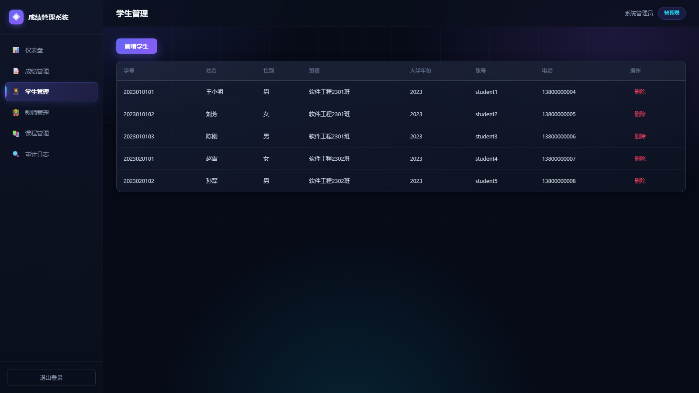
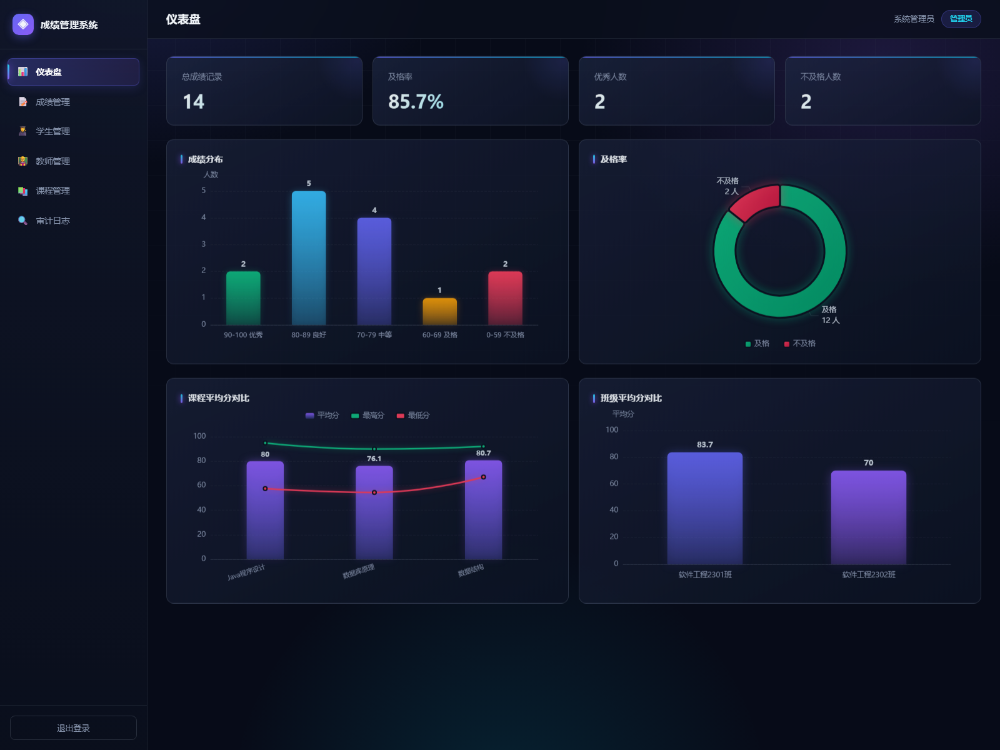

# 学生成绩管理系统

> 基于 B/S 架构与前后端分离技术的学生成绩管理系统
> 课程设计 / 毕业论文配套实现

---

## 一、快速启动

### 方式一：一键启动（推荐）

双击项目根目录下的 **`start.bat`**

脚本会自动：
1. 定位内置 JDK
2. 启动后端服务（端口 8080）
3. 等待服务就绪
4. 自动打开浏览器

停止服务：双击 **`stop.bat`**

### 方式二：手动启动

```bash
# 进入后端目录
cd backend

# 用内置 JDK 启动
..\env\jdk\jdk-21.0.12.1+1\bin\java.exe -Djava.io.tmpdir=..\tmp -jar target\student-grade-system-1.0.0.jar
```

然后浏览器访问：**http://localhost:8080**

---

## 二、演示账号

| 角色 | 账号 | 密码 | 权限说明 |
|------|------|------|----------|
| 管理员 | `admin` | `123456` | 全部 18 项权限 |
| 教师 | `teacher1` | `123456` | 查看学生/课程、成绩录入修改、审计日志、统计 |
| 学生 | `student1` | `123456` | 仅查看本人成绩与统计 |

> 其他账号：`teacher2`、`student2`~`student5`，密码均为 `123456`

---

## 三、技术栈

| 层次 | 技术 | 说明 |
|------|------|------|
| 后端框架 | Spring Boot 3.3.5 | 主流企业级框架 |
| 持久层 | Spring Data JPA + Hibernate 6.5 | ORM 映射 |
| 数据库 | H2 2.2（MySQL 兼容模式） | 零安装，附 MySQL 脚本 |
| 数据库驱动 | H2 / MySQL Connector-J | 双驱动支持 |
| 安全 | Spring Security Crypto (BCrypt) | 密码单向加密 |
| 参数校验 | Jakarta Validation | 声明式校验 |
| 前端 | 原生 HTML/CSS/JavaScript | B/S 架构 |
| 可视化 | Apache ECharts 5.5 | 图表库 |
| 运行时 | JDK 21.0.12 LTS | 内置免安装 |
| 构建 | Maven 3.9.9 | 内置 |

---

## 四、系统架构

```
┌─────────────────────────────────────────────┐
│              浏览器（B/S 前端）                │
│   HTML + CSS + JavaScript + ECharts          │
└──────────────────┬──────────────────────────┘
                   │ HTTP / JSON (RESTful)
                   │ Token 认证 (Authorization 头)
┌──────────────────▼──────────────────────────┐
│           Spring Boot 后端                   │
│  ┌────────────────────────────────────────┐ │
│  │  Controller 层  （接口定义）             │ │
│  ├────────────────────────────────────────┤ │
│  │  AuthInterceptor （登录校验）           │ │
│  ├────────────────────────────────────────┤ │
│  │  Service 层  （业务逻辑 + 权限判断）     │ │
│  │   ├─ AuthService      认证              │ │
│  │   ├─ ScoreService     成绩+折算+审计    │ │
│  │   ├─ StatisticsService 统计聚合         │ │
│  │   └─ BasicInfoService 基础信息          │ │
│  ├────────────────────────────────────────┤ │
│  │  Repository 层 （数据访问）             │ │
│  ├────────────────────────────────────────┤ │
│  │  Entity 层 （实体映射）                 │ │
│  └────────────────────────────────────────┘ │
└──────────────────┬──────────────────────────┘
                   │ JDBC
┌──────────────────▼──────────────────────────┐
│         H2 / MySQL 数据库                    │
│  用户·角色·权限·学生·教师·课程·成绩·日志       │
└─────────────────────────────────────────────┘
```

---

## 五、RBAC 权限模型

采用经典的 **RBAC（基于角色的访问控制）** 五表模型：

```
sys_user ──┐
           ├── sys_user_role ──── sys_role ──── sys_role_permission ──── sys_permission
           │    (多对多)              (多对多)
           │
info_student / info_teacher
```

**设计要点：**

1. **用户与角色多对多** —— 一个用户可拥有多个角色
2. **角色与权限多对多** —— 角色是权限的集合
3. **权限编码化** —— 如 `score:input`、`student:delete`，便于注解式校验
4. **业务信息分离** —— 登录信息在 `sys_user`，业务属性在 `info_student` / `info_teacher`

**权限清单（18 项）：**

| 模块 | 权限编码 |
|------|----------|
| 学生 | `student:view` `student:add` `student:edit` `student:delete` |
| 教师 | `teacher:view` `teacher:add` `teacher:edit` `teacher:delete` |
| 课程 | `course:view` `course:add` `course:edit` `course:delete` |
| 成绩 | `score:view` `score:input` `score:edit` `score:audit` |
| 统计 | `stats:view` |
| 用户 | `user:manage` |

---

## 六、核心算法：成绩折算

### 折算公式

```
总评成绩 = 平时成绩 × w1 + 期中成绩 × w2 + 期末成绩 × w3
```

权重存储于 `score_rule` 表，**可按课程单独配置**：

| 课程 | 平时 | 期中 | 期末 |
|------|------|------|------|
| Java程序设计 | 30% | 20% | 50% |
| 数据库原理 | 20% | 30% | 50% |
| 数据结构 | 30% | 20% | 50% |

### 缺失分项的处理

若某分项未录入（如无期中考试），按**剩余权重归一化**计算：

```
总评 = Σ(已有分项 × 对应权重) / Σ(已有分项权重)
```

这样避免"缺考直接判定 0 分"的不合理情况。

### 绩点换算规则

| 总评区间 | 绩点 | 等级 |
|----------|------|------|
| 90 ~ 100 | 4.0 | 优秀 |
| 85 ~ 89 | 3.7 | 良好 |
| 82 ~ 84 | 3.3 | 良好 |
| 78 ~ 81 | 3.0 | 中等 |
| 75 ~ 77 | 2.7 | 中等 |
| 72 ~ 74 | 2.3 | 中等 |
| 68 ~ 71 | 2.0 | 及格 |
| 64 ~ 67 | 1.5 | 及格 |
| 60 ~ 63 | 1.0 | 及格 |
| 0 ~ 59 | 0.0 | 不及格 |

---

## 七、成绩安全录入机制

针对"成绩安全录入"这一研究重点，系统实现三重保障：

### 1. 参数校验
所有分数通过 `@DecimalMin` / `@DecimalMax` 限制在 0~100 范围，非法输入直接拒绝。

### 2. 权限校验
录入与修改分别对应 `score:input` 和 `score:edit` 权限；学生角色**无任何写入权限**，尝试提交返回 403。

### 3. 审计日志
每次成绩变更自动写入 `score_log` 表，记录：

- 操作人 ID
- 动作类型（`INSERT` 新增 / `UPDATE` 修改）
- 修改前内容
- 修改后内容
- 操作时间

管理员和教师可在「审计日志」页面查看全部变更记录，实现**全链路可追溯**。

---

## 八、统计可视化（ECharts）

系统提供 4 类图表 + 3 项核心指标：

| 图表 | 类型 | 数据接口 |
|------|------|----------|
| 成绩分布 | 柱状图 | `/api/stats/distribution` |
| 及格率 | 环形饼图 | `/api/stats/pass-rate` |
| 课程平均分对比 | 柱状+折线 | `/api/stats/course-average` |
| 班级平均分对比 | 柱状图 | `/api/stats/class-average` |

**学生个人趋势图**：`/api/stats/student-trend/{studentId}`

所有统计通过 SQL 聚合在数据库端完成，前端只负责渲染，**避免大数据量传输**。

---

## 九、数据库查看（答辩演示）

系统内置 **H2 Web 控制台**，可在浏览器中直接查看表结构和数据。

### 访问步骤

1. 浏览器打开：**http://localhost:8080/h2-console**

2. 填写连接信息：

| 字段 | 值 |
|------|-----|
| Driver Class | `org.h2.Driver` |
| JDBC URL | `jdbc:h2:mem:sgs` |
| User Name | `sa` |
| Password | （留空） |

3. 点击 **Connect**

4. 在 SQL 输入框执行查询，例如：

```sql
-- 查看所有表
SELECT * FROM INFORMATION_SCHEMA.TABLES WHERE TABLE_SCHEMA = 'PUBLIC';

-- 查看用户与角色关系
SELECT u.username, u.real_name, r.role_code, r.role_name
FROM sys_user u
JOIN sys_user_role ur ON ur.user_id = u.id
JOIN sys_role r ON r.id = ur.role_id;

-- 查看成绩明细
SELECT st.stu_no, u.real_name, c.course_name,
       s.usual_score, s.midterm_score, s.final_score,
       s.total_score, s.grade_point
FROM score s
JOIN info_student st ON st.id = s.student_id
JOIN sys_user u ON u.id = st.user_id
JOIN course c ON c.id = s.course_id;

-- 查看审计日志
SELECT * FROM score_log ORDER BY operate_time DESC;

-- 查看角色权限分配
SELECT r.role_name, p.perm_code, p.perm_name
FROM sys_role r
JOIN sys_role_permission rp ON rp.role_id = r.id
JOIN sys_permission p ON p.id = rp.perm_id
ORDER BY r.id, p.id;
```

---

## 十、切换到 MySQL

### 1. 准备数据库

```bash
mysql -u root -p < db/schema-mysql.sql
mysql -u root -p < db/data-mysql.sql
```

### 2. 修改连接配置

编辑 `backend/src/main/resources/application-mysql.yml`：

```yaml
spring:
  datasource:
    username: root
    password: 你的密码
```

### 3. 以 mysql 配置启动

```bash
java -jar target/student-grade-system-1.0.0.jar --spring.profiles.active=mysql
```

---

## 十一、目录结构

```
student-grade-system/
├── start.bat                     一键启动
├── stop.bat                      停止服务
├── README.md                     本文档
│
├── db/                           MySQL 脚本
│   ├── schema-mysql.sql          建表
│   └── data-mysql.sql            初始化数据
│
├── env/                          内置运行环境
│   ├── jdk/                      JDK 21（免安装）
│   ├── maven/                    Maven 3.9.9
│   ├── m2repo/                   Maven 依赖缓存
│   └── settings.xml              Maven 配置
│
├── backend/                      后端工程
│   ├── pom.xml
│   ├── data/                     H2 数据库文件（运行后生成）
│   ├── target/                   构建产物
│   │   └── student-grade-system-1.0.0.jar
│   └── src/main/
│       ├── java/com/sgs/
│       │   ├── StudentGradeSystemApplication.java
│       │   ├── common/           统一响应、异常处理
│       │   ├── config/           Web 配置、数据校验
│       │   ├── controller/       REST 接口
│       │   ├── dto/              数据传输对象
│       │   ├── entity/           实体类
│       │   ├── repository/       数据访问
│       │   ├── security/         认证、拦截器、上下文
│       │   └── service/          业务逻辑
│       └── resources/
│           ├── application.yml           主配置
│           ├── application-mysql.yml     MySQL 配置
│           ├── db/schema-h2.sql          H2 建表
│           ├── db/data-h2.sql            H2 数据
│           └── static/                   前端资源（打包进 JAR）
│
└── frontend/                     前端源码（已复制进 static）
    ├── index.html
    ├── css/style.css
    └── js/
        ├── api.js                接口封装
        └── app.js                页面逻辑
```

---

## 十二、接口清单

| 方法 | 路径 | 说明 | 所需权限 |
|------|------|------|----------|
| POST | `/api/auth/login` | 登录 | 公开 |
| POST | `/api/auth/logout` | 退出 | 已登录 |
| GET | `/api/auth/me` | 当前用户 | 已登录 |
| POST | `/api/auth/change-password` | 修改密码 | 已登录 |
| GET | `/api/scores` | 成绩列表 | `score:view` |
| POST | `/api/scores` | 录入/修改成绩 | `score:input`/`edit` |
| GET | `/api/scores/logs` | 审计日志 | `score:audit` |
| GET | `/api/basic/students` | 学生列表 | `student:view` |
| POST | `/api/basic/students` | 新增学生 | `student:add` |
| DELETE | `/api/basic/students/{id}` | 删除学生 | `student:delete` |
| GET | `/api/basic/teachers` | 教师列表 | `teacher:view` |
| POST | `/api/basic/teachers` | 新增教师 | `teacher:add` |
| GET | `/api/basic/courses` | 课程列表 | `course:view` |
| POST | `/api/basic/courses` | 新增课程 | `course:add` |
| GET | `/api/basic/classes` | 班级列表 | 已登录 |
| GET | `/api/stats/distribution` | 成绩分布 | `stats:view` |
| GET | `/api/stats/course-average` | 课程均分 | `stats:view` |
| GET | `/api/stats/class-average` | 班级均分 | `stats:view` |
| GET | `/api/stats/pass-rate` | 及格率 | `stats:view` |
| GET | `/api/stats/student-trend/{id}` | 学生趋势 | `stats:view` |
| GET | `/api/stats/semesters` | 学期列表 | 已登录 |

---

## 十三、常见问题

**Q：启动时提示端口 8080 被占用？**

先运行 `stop.bat`，或检查是否有其他 Java 进程：
```bash
netstat -ano | findstr :8080
```

**Q：想重置数据库？**

删除 `backend/data/` 目录，重启服务即可自动重新初始化。

**Q：页面打开空白？**

确认访问的是 `http://localhost:8080`（不是 `file://` 路径）。

**Q：忘记密码？**

所有演示账号密码均为 `123456`。如需重置，删除 `backend/data/` 后重启。

---

## 十四、论文可用的技术要点

> 以下内容可直接用于论文的"系统实现"与"关键技术"章节

1. **前后端分离架构** —— 前端通过 RESTful API 与后端交互，使用 JSON 传输数据，前后端可独立开发部署

2. **RBAC 五表模型** —— 用户-角色-权限三层多对多关系，实现细粒度权限控制

3. **Token 认证机制** —— 登录成功后服务端生成 UUID 令牌，客户端通过 `Authorization: Bearer xxx` 头传递，拦截器统一校验

4. **BCrypt 密码加密** —— 采用加盐哈希算法，即使数据库泄露也无法直接还原明文密码

5. **成绩折算的归一化算法** —— 缺失分项时按剩余权重归一化，提升算法鲁棒性

6. **审计日志设计** —— 记录变更前后快照，实现数据可追溯，满足教务管理合规性要求

7. **数据库端聚合统计** —— 使用 SQL 的 `SUM`/`CASE WHEN`/`GROUP BY` 完成统计，减少应用层计算与网络传输

8. **配置化权重** —— 折算权重存储于数据库而非硬编码，支持不同课程差异化配置


---

## 十五、界面截图

| 登录页 | 成绩管理 |
|---|---|
|  |  |

| 学生管理 | 数据看板 |
|---|---|
|  |  |
