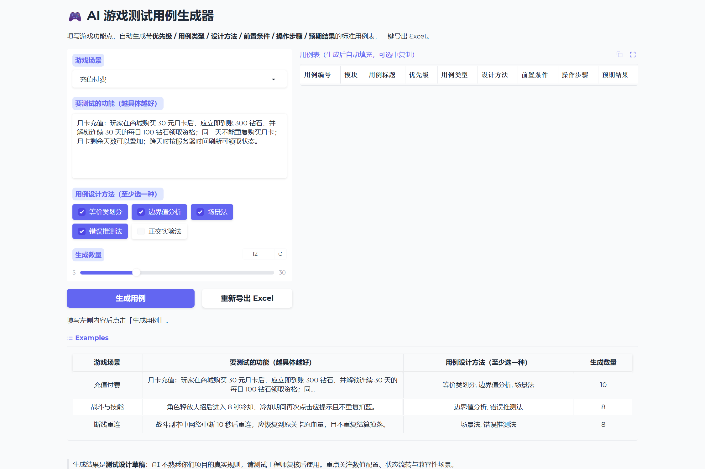

# AI 游戏测试用例生成器

> 输入一段游戏功能描述，自动产出**可直接进 Excel 的标准测试用例表**：用例编号、优先级、用例类型、设计方法、前置条件、操作步骤、预期结果。
> 基于 **Python + Gradio + 大模型 API**，内置 8 个游戏测试场景、5 种用例设计方法，支持分批生成、去重编号、一键导出 Excel。

一句话：**把「手写用例表」变成「描述功能点 → 得到用例表 → 复核修改」。**

---

## 功能

| 功能 | 说明 |
|---|---|
| 8 个游戏场景模板 | 登录与注册、充值付费、战斗与技能、背包与道具、组队与匹配、断线重连、活动与签到、通用/自定义；每个场景预置业务点与高风险点，直接喂给模型 |
| 5 种用例设计方法 | 等价类划分、边界值分析、场景法、错误推测法、正交实验法，可多选；勾了哪种方法，模型就必须按该思路产出用例 |
| 标准用例字段 | 用例编号 / 模块 / 标题 / 优先级(P0–P3) / 用例类型(功能·边界·异常·兼容·性能·安全) / 设计方法 / 前置条件 / 操作步骤 / 预期结果 |
| 分批生成 | 一次要 30 条会掉质量，所以自动按每批 12 条拆分调用，再合并去重 |
| 自动编号去重 | 合并后按优先级排序、按「标题 + 预期结果」去重，重新从 TC-001 连续编号 |
| 一键导出 Excel | 输出带表头样式、冻结首行、自动筛选的工作簿，另附「统计」页 |
| 生成质量提示 | 自动提醒：实际条数不足、字段缺失被丢弃、重复被去重、P0 占比过高等 |
| 容错解析 | 代码块包裹、前后废话、尾逗号、中文引号、单条对象、裸数组都能解析 |
| 失败重试 | 429/5xx/超时自动重试；401/404 等直接翻译成中文提示 |
| 离线可测 | 74 个 pytest 用例全部不联网、不消耗接口额度 |

---

## 界面预览



---

## 快速开始

### 1. 环境要求

- Windows 10 / 11
- Python 3.10+（本项目在 3.13 上验证）
- 一个兼容 OpenAI 协议的大模型 API Key

### 2. 安装依赖

```powershell
cd ai-game-test-case-generator
python -m venv .venv
.\.venv\Scripts\python.exe -m pip install -r requirements.txt
```

### 3. 配置 API Key

```powershell
Copy-Item .env.example .env
```

打开 `.env`，至少填 `LLM_API_KEY`：

```ini
LLM_API_KEY=sk-你的真实密钥
LLM_BASE_URL=https://api.deepseek.com/v1
LLM_MODEL=deepseek-chat
```

> 支持 DeepSeek / 智谱 / 通义 / 月之暗面 / OpenAI / 本地 Ollama，换平台只改这两行，代码不用动。
> `.env` 已在 `.gitignore` 里，不会被提交。

### 4. 启动

```powershell
.\.venv\Scripts\python.exe app.py
```

或双击 `run.bat`。浏览器自动打开 <http://127.0.0.1:7862>。

### 5. 跑测试

```powershell
.\.venv\Scripts\python.exe -m pytest tests -q
```

预期结果：`74 passed`，全程不联网。

---

## 怎么用

1. 选一个**游戏场景**（如「充值付费」），场景会带出该模块的常见业务点与高风险点
2. 在「要测试的功能」里写清**输入、规则、期望**（写得越具体，用例越准）
3. 勾选本次要用的**用例设计方法**（至少一种）
4. 拖动滑块选生成数量（5–30 条）
5. 点「生成用例」，右侧表格出现用例，下方显示统计
6. 复核后点「重新导出 Excel」（或生成时自动导出一份到 `exports/`）

> ⚠️ 生成结果是**测试设计草稿**：AI 不了解你们项目的真实规则与数值，必须由测试工程师复核。

---

## 用例字段说明

| 字段 | 说明 | 示例 |
|---|---|---|
| 用例编号 | 程序自动生成，按优先级排序后连续编号 | `TC-001` |
| 模块 | 本次选择的游戏场景 | `充值付费` |
| 用例标题 | 一句话说清"在什么情况下验证什么" | 已拥有月卡时重复购买应提示并禁止下单 |
| 优先级 | P0 主流程 / P1 重要分支 / P2 一般 / P3 低频 | `P0` |
| 用例类型 | 功能 / 边界 / 异常 / 兼容 / 性能 / 安全 | `异常` |
| 设计方法 | 该用例依据的设计思路 | `错误推测法` |
| 前置条件 | 账号状态、数据准备、环境要求 | 账号已购买月卡，剩余 12 天 |
| 操作步骤 | 3–6 步可执行动作 | 1. 进入商城月卡页 2. 点击购买 |
| 预期结果 | 可观察、可判定的结果 | 弹出"月卡不可重复购买"提示，订单未创建 |

---

## 支持的游戏场景（内置领域知识）

| 场景 | 预置关注点 | 高风险点（喂给模型的重点） |
|---|---|---|
| 登录与注册 | 账号/验证码/第三方/实名/找回密码 | 验证码过期、弱密码、重复注册、异地登录 |
| 充值付费 | 档位/首充/月卡/回调补单/退款 | 支付成功不到账、重复订单、回调丢失、分转元精度 |
| 战斗与技能 | 技能冷却/伤害结算/Buff/掉落 | 冷却期连点、状态残留、数值溢出、帧率波动 |
| 背包与道具 | 获得/扩容/堆叠/过期/装备 | 满背包获得、数量为 0、堆叠溢出、使用中丢弃 |
| 组队与匹配 | 组队/匹配/踢人/副本结算 | 并发状态错乱、匹配中下线、人数上限 |
| 断线重连 | 弱网/切后台/恢复/结算/顶号 | 状态丢失或重复、重连期扣体力、重连风暴 |
| 活动与签到 | 签到/活动时间/重复领取/排行榜 | 跨天时区、结束瞬间边界、并发领取、刷分 |
| 通用/自定义 | 按描述自行归纳 | 需求不完整导致覆盖不足 |

新增场景只需在 `prompts.py` 的 `GAME_SCENES` 里加一项，界面下拉、提示词、统计自动适配。

---

## 项目结构

```
ai-game-test-case-generator/
├─ app.py                   入口：读配置 → 建界面 → 启动（import 不会启动服务）
├─ config.py                .env 读取、类型解析、范围校验、Key 脱敏
├─ prompts.py               场景库 + 设计方法库 + 系统/用户提示词组装
├─ services/
│  ├─ llm_client.py         OpenAI 兼容调用 + 重试 + 中文错误翻译
│  └─ generator.py          校验 → 分批调用 → 解析 → 去重 → 编号
├─ utils/
│  ├─ parser.py             四层兜底抠 JSON + 字段归一化 + 脏数据丢弃
│  ├─ case_model.py         编号、排序、去重、统计、表格行
│  └─ exporter.py           导出 Excel（表头样式 + 冻结 + 筛选 + 统计页）
├─ ui/
│  └─ layout.py             Gradio 界面：表单、表格、统计、下载
├─ tests/                   74 个离线单元测试
├─ docs/ui-home.png         界面截图
├─ .env.example             配置模板
├─ requirements.txt / requirements-dev.txt
├─ run.bat                  一键启动
└─ README.md
```

### 数据流

```
用户填写场景 + 功能 + 方法 + 数量
        ↓
services/generator.py    输入校验 → 按每批 12 条拆分
        ↓
prompts.py               场景业务点/风险点 + 设计方法说明 → system + user 消息
        ↓
services/llm_client.py   OpenAI 兼容接口（JSON 模式）→ 失败重试 → 中文错误
        ↓
utils/parser.py          剥代码块 → 截取 JSON → 修尾逗号/中文引号 → 字段校验
        ↓
utils/case_model.py      跨批去重 → 按优先级排序 → TC-001 连续编号 → 统计
        ↓
ui/layout.py             表格展示 + 质量提醒 + 导出 Excel
```

---

## 测试

```powershell
.\.venv\Scripts\python.exe -m pytest tests -q
```

**74 个用例，全部离线**（用假客户端替换网络调用），覆盖：

- `test_config.py`：默认值、环境变量覆盖、温度/端口/数量越界、Key 脱敏与占位符检测
- `test_parser.py`：代码块/废话/裸数组/尾逗号/中文引号解析、优先级与类型归一化、脏数据丢弃计数
- `test_case_model.py`：连续编号、按优先级排序、标题+预期去重、统计与 P0 占比告警
- `test_prompts.py`：场景库与方法库规模、消息角色、提示词是否包含功能/方法/数量
- `test_generator.py`：分批调用次数、超量截断、解析失败跳过、全失败抛错、跨批去重、6 种非法输入

> 为什么值得写这些测试：提示词一改，用例质量就变。有了这套测试，改完能立刻知道"解析、编号、去重、统计"有没有被改坏。

---

## 常见问题

| 现象 | 原因与处理 |
|---|---|
| 提示"还没有配置 API Key" | 把 `.env.example` 复制为 `.env` 并填 `LLM_API_KEY`，重启 |
| 提示 401 | Key 填错或带了空格；确认 Key 与 `LLM_BASE_URL` 是同一个平台 |
| 提示 404 | 地址要带 `/v1` 结尾；模型名拼写要对 |
| 提示 429 | 限流或余额不足，减少数量、稍后重试 |
| 生成的 JSON 解析失败 | 平台不支持 JSON 模式时把 `.env` 的 `JSON_MODE` 改 0 |
| 用例条数比目标少 | 模型一次输出有限，再点一次生成补足；或减少单次数量 |
| 复用的用例总是很像 | 换设计方法组合、把功能描述写得更具体 |
| 端口被占用 | 改 `.env` 里的 `APP_PORT` |

---

## 技术要点（面试可讲）

1. **为什么不一次性生成 30 条**：模型输出越长越容易敷衍、越容易超 token；按 12 条分批，每批独立校验，质量更稳。
2. **JSON 解析为什么这么麻烦**：模型会包代码块、写前言、留尾逗号、用中文引号；四层兜底比"报错让用户重试"体验好得多。
3. **为什么要去重**：分批生成时相邻批次容易重复；按"标题 + 预期结果"归一化去重后再连续编号，保证交付的表不重不乱。
4. **P0 占比告警**：模型倾向把所有用例都标成高优先级；占比超过 34% 时提示复核，避免优先级失去区分度。
5. **提示词与代码分离**：场景和方法都是数据（dataclass/dict），加一个场景不用改界面和业务逻辑。

---

## 说明

- 本项目用于学习与效率实践，生成内容需人工复核，不能替代测试工程师的判断
- API Key 与调用费用由使用者自行承担；`.env` 不要提交到任何仓库
- 大模型可能产生不准确的规则描述，涉及数值配置请以需求文档为准
