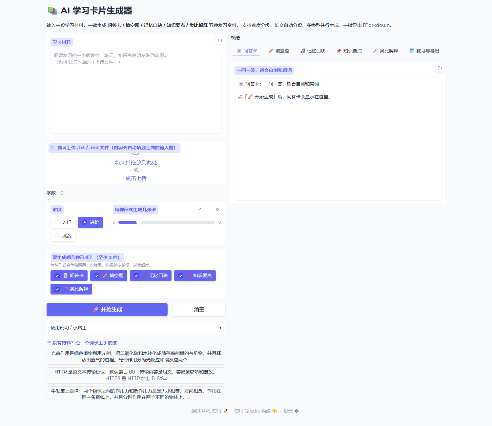
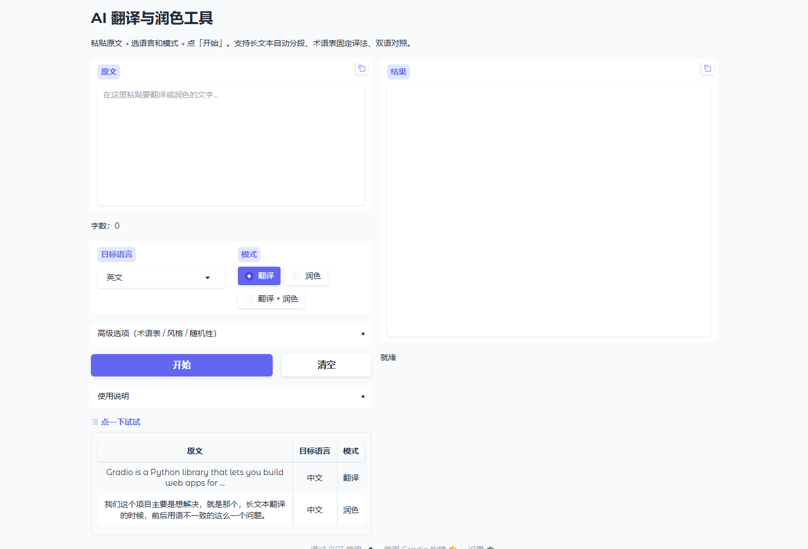
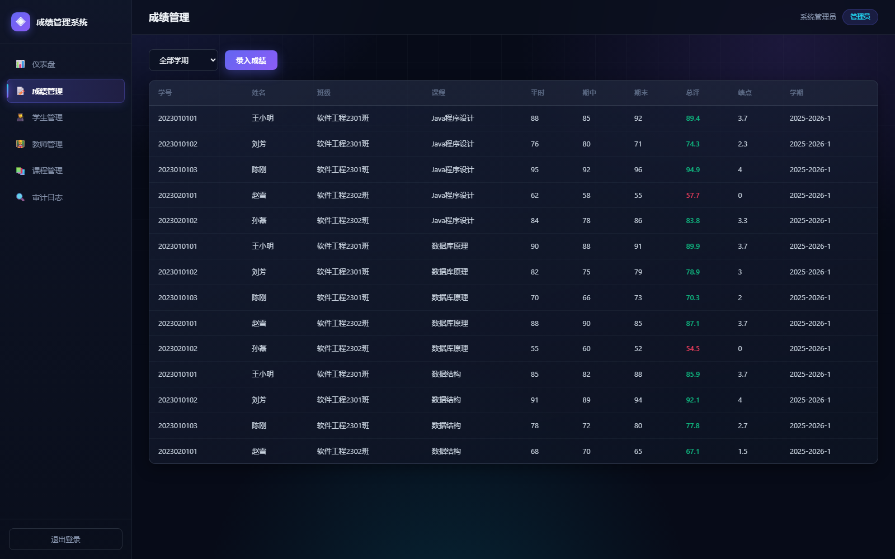

# 陈国成 · 个人作品集

> 2027 届 · 广东创新科技职业学院 · 软件技术（专科）
> 4 个**个人独立完成**的项目，累计 **211 个自动化测试用例**

## 关于我

- 方向：**AI 大模型应用开发** / **软件测试（游戏测试方向）**
- 习惯：每个项目都配套离线自测脚本，改完代码先跑测试再交付，保证「没改坏」
- 联系：13268679617 ｜ 2122361382@qq.com

## 项目一览

| # | 项目 | 技术栈 | 自测用例 | 一句话说明 |
|---|------|--------|:---:|------------|
| 01 | [AI 智能写作助手](01-ai-writing-assistant/) | Python · Gradio · 大模型流式接口 | **119**（pytest） | 5 种写作场景 × 3 种语气，提示词模板由数据类驱动 |
| 02 | [AI 学习卡片生成器](02-ai-study-cards/) | Python · Gradio · 线程池 · JSON 模式 | **68** | 输入材料生成 5 种复习卡片，多类型并行 + 一键导出 |
| 03 | [AI 翻译与润色工具](03-ai-translator/) | Python · Gradio · 大模型接口 | **24** | 7 种语言、三模式、术语表、长文本三级切分 |
| 04 | [学生成绩管理系统](04-student-grade-system/) | Java · Spring Boot 3 · JPA · ECharts | 20+ 接口验证 | 毕业设计：B/S 架构，RBAC 权限 + 成绩折算 + 审计日志 |

## 界面截图

| AI 智能写作助手 | AI 学习卡片生成器 |
|---|---|
|  |  |

| AI 翻译与润色工具 | 学生成绩管理系统 |
|---|---|
|  |  |

## 每个项目怎么跑

每个目录下都有自己的 `README.md`，包含：环境要求、依赖安装、配置方式、启动命令、测试命令。
通用步骤：

```bash
cd 项目目录
python -m venv .venv                 # 建虚拟环境
.venv\Scripts\activate               # Windows 激活
pip install -r requirements.txt      # 装依赖
copy .env.example .env               # 复制配置模板，填入自己的 API Key
python app.py                        # 启动
```

> ⚠️ 仓库里**不含任何真实 API Key**：`.env` 已在 `.gitignore` 中排除，只保留 `.env.example` 模板。

## 说明

- 以上 4 个项目均由本人独立完成：需求梳理、编码实现、测试验证、文档与答辩材料
- 项目用于学习与实践演示，接口费用由使用者自行承担
- 大模型接口兼容 OpenAI 协议，可换成 DeepSeek / 智谱 / 通义 / 月之暗面 / 本地 Ollama，只需改 `.env` 两行
